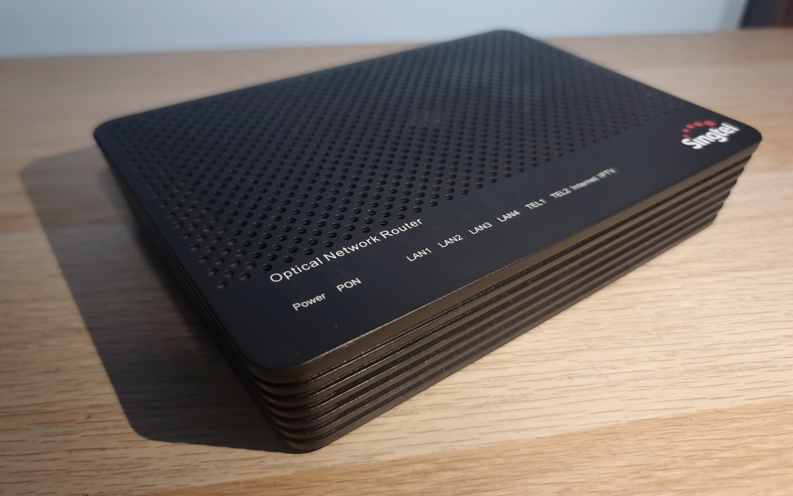

<h1 align="center">Huawei HG8240T5</h1>

  

Hardware, firmware and management-interface research on a retired **Huawei HG8240T5 optical network router (ONR)**, with possible reuse as a longer-term goal.

The tested device runs firmware customized for [Singtel](https://www.singtel.com/), an internet service provider (ISP) in Singapore. Findings apply to the **SINGTEL2 build tested here**; other units and firmware may differ.

## Findings and vulnerabilities

- **[ONR-WEB-001 — unauthenticated information exposure](docs/findings/ONR-WEB-001.md):** four WAN/ONT resources returned configuration and device-state data without login on the tested management LAN. Internet-side exposure was not established.
- **Data exposed:** three WAN profiles, MAC addresses, VLAN/service settings, connection flags and optical network terminal (ONT) state.
- **Unresolved:** a password-labelled field held the same opaque 64-character hexadecimal value across profiles. Its meaning and usability remain unverified; no password was recovered.
- **Hardware:** the [hardware guide](docs/hardware.md) covers PCB photographs, component identification and evidence limits.
- **Access limits:** no shell, arbitrary command execution, firmware dump or verified UART pinout has been obtained.

## Start here

- [Device and firmware](docs/device.md)
- [Hardware and photographs](docs/hardware.md)
- [Finding summary and limits](docs/findings/ONR-WEB-001.md)
- [Offline tools: first example](tools/README.md#first-offline-example)
- [All documentation](docs/README.md)

## Tools used

### Research and analysis

- **Codex:** code, analysis and writing.
- **Playwright:** browser usage for codex.
- **Ollama + Qwen3 32B:** local AI for actions restricted by [OpenAI Daybreak](https://openai.com/daybreak/).
- **[REA by Morlulo](https://github.com/morluto/rea):** for its read only tools.
- **Python, Rust and Node.js:** processing data and scripts.
- **[Babel](https://babeljs.io/):** JavaScript syntax-tree parsing.

### Photographs and image processing

- **OpenCV + SciPy:** image registration and alignment refinement.
- **focus-stack:** combining selected frames for sharper focus.
- **tifffile:** lossless TIFF/BigTIFF exports.
- **GIMP:** photo edits and redaction.
- **ExifTool:** metadata inspection and removal.

See [tool roles and limitations](docs/tooling.md), [local model setup](docs/local-models.md) and the [photo mosaic workflow](tools/photo-mosaic/README.md). Tool use does not establish the correctness of a finding; conclusions require supporting evidence.

## Safety and ownership

AI assisted with code, analysis and documentation; errors may remain. Experimental hardware work can cause injury, damage, data loss or service disruption. Equipment testing requires authorization; the [full disclaimer](DISCLAIMER.md) describes the limitations.

Original contributions use the [MIT License](LICENSE), with **ABSOLUTELY NO WARRANTY**, to the extent permitted by applicable law. Device hardware and original firmware are third-party works outside the repository license. See [ownership and license scope](NOTICE.md).
