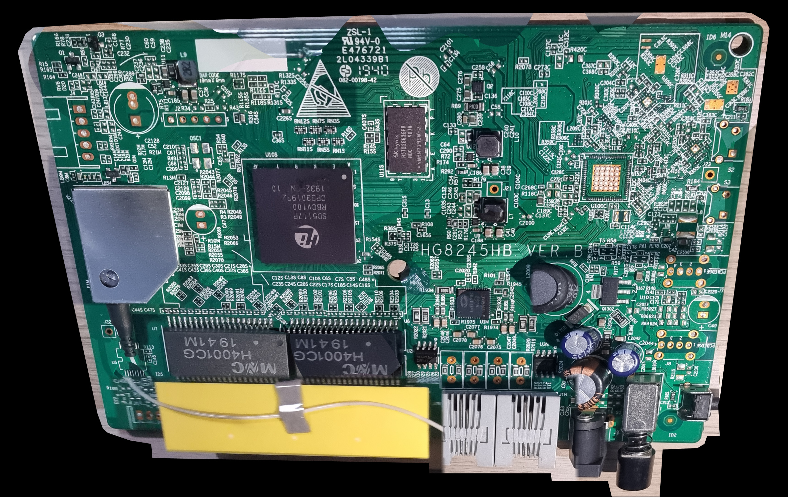

# Hardware and photographs

I compared photographs with manufacturer documentation to identify the hardware. The photographs below show PCB backside details and a component-side composite.

| Component | Identification from research | Limit |
| --- | --- | --- |
| Main processor | HiSilicon SD5117P / RBCV100 marking | Exact clocks, enabled cores and pad routing unverified |
| DRAM | SK hynix H5TQ2G63GFR-RDC, 2 Gbit / 256 MiB DDR3 | Part capacity, not a live usable-memory measurement |
| Flash at U2S | Winbond W25N01GVZEIG, 1 Gbit / 128 MiB SPI NAND | Contents and actual board voltage unmeasured |
| Ethernet magnetics | MNC / Mentech H4001CG | Part identification alone does not establish board throughput |
| Telephone interface at U1N | Le9642PQC | Presence does not establish active voice service |
| Protection at U2N/U3N | ST LCP1521S family, CP152S marking | Routing and protection performance unmeasured |

Manufacturer and related-device sources are listed in [references](references.md). Related-device ARM/Linux evidence is supporting inference, not a board-specific boot log.

## Public photographs

Single-frame detail of the connector region. I kept the original framing, removed identifying metadata and selected this frame because it excludes the identifying sticker.

A second single-frame view of backside traces and footprints. Focus and glare limit fine-lettering interpretation. No component function or signal assignment is inferred from appearance alone.

Both images retain original encoded pixel data, without AI-generated reconstruction. Original files are unchanged. See [image provenance](../images/README.md).

## Component side — bottom-facing inside the device

I used a 1,297-photo dataset to prepare this composite. The local lossless master is 13,311 × 8,407 pixels; this documentation image is a reduced JPEG. I used PCB-surface registration, native focus selection, a reviewed capacitor-region focus stack and coherent source views for raised components. Outside-scene background was removed without inpainting or generated detail.

Originals remain unchanged. Source softness, lighting differences and small local seam or perspective errors can remain. The composite is not a calibrated measurement. See [image provenance](../images/README.md).

## Unresolved hardware questions

The previously observed five-pad footprint is only a debug-interface candidate: function, pinout and voltage remain unverified. Unpopulated footprints and USB/WLAN silkscreen are not proof of functioning interfaces. No wiring instructions are provided.

The full-board backside mosaic contains an identifying sticker. The component-side composite is shown above. Deleted loose photographs were not restored from backups.

---

[Next page: Finding summary and limits →](findings/ONR-WEB-001.md)
