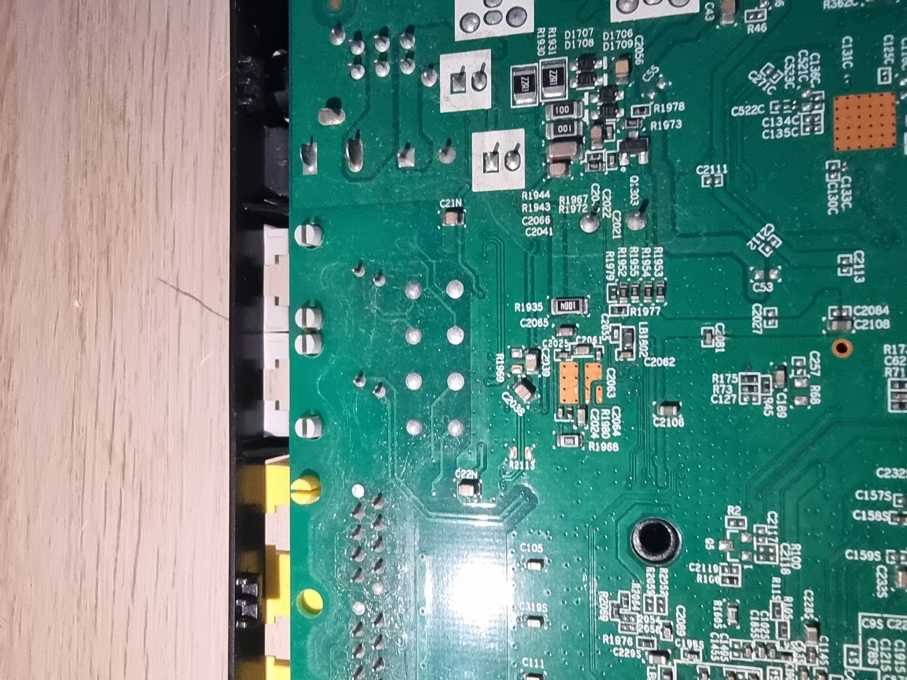
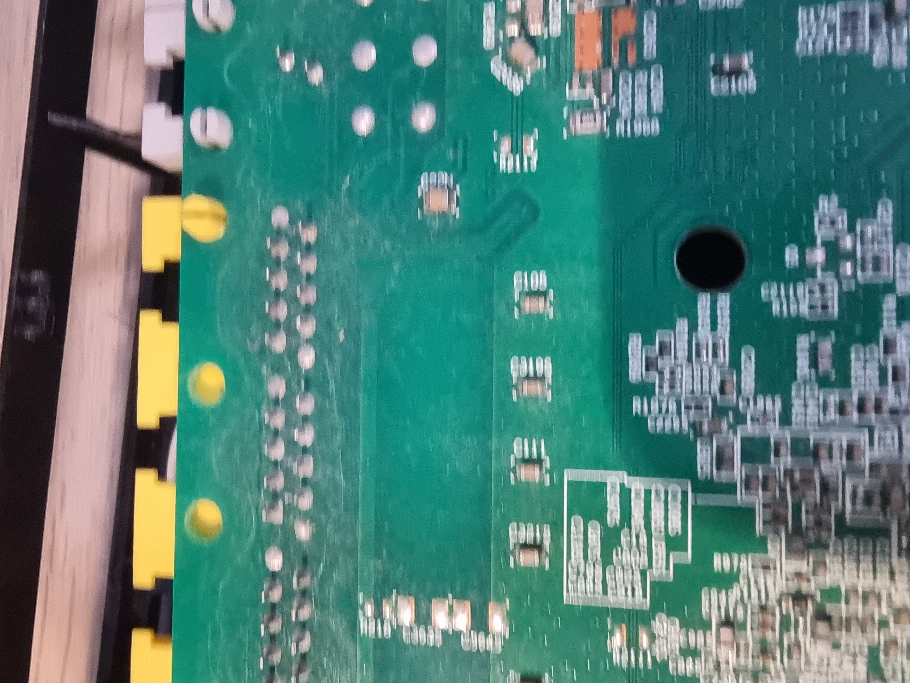

# Hardware and photographs

Hardware identification combines earlier private photograph review with manufacturer documentation. The public images below show the newly photographed PCB backside, not the full evidence set for every component identification.

| Component | Identification from research | Limit |
| --- | --- | --- |
| Main processor | HiSilicon SD5117P / RBCV100 marking | Exact clocks, enabled cores and pad routing unverified |
| DRAM | SK hynix H5TQ2G63GFR-RDC, 2 Gbit / 256 MiB DDR3 | Part capacity, not a live usable-memory measurement |
| Flash at U2S | Winbond W25N01GVZEIG, 1 Gbit / 128 MiB SPI NAND | Contents and actual board voltage unmeasured |
| Ethernet magnetics | MNC / Mentech H4001CG | Part identification alone does not establish board throughput |
| Telephone interface at U1N | Le9642PQC | Presence does not establish active voice service |
| Protection at U2N/U3N | ST LCP1521S family, CP152S marking | Routing and protection performance unmeasured |

Manufacturer and related-device sources are listed in [references](references.md). Related-device ARM/Linux evidence is supporting inference, not a board-specific boot log.

## Public photographs

Connector-side detail from one owner-provided frame. Original framing is retained; identifying metadata was removed from the public copy. This frame was selected because it excludes the identifying sticker.

A second single-frame view of backside traces and footprints. Focus and glare limit fine-lettering interpretation. No component function or signal assignment is inferred from appearance alone.

These two images retain original encoded pixel data. They are not AI-generated reconstructions. Originals remain private and unchanged. See [image provenance](../images/README.md).

## Unresolved hardware questions

The previously observed five-pad footprint is only a debug-interface candidate: function, pinout and voltage remain unverified. Unpopulated footprints and USB/WLAN silkscreen are not proof of functioning interfaces. No wiring instructions are provided.

The existing full-board mosaic contains an identifying sticker and is omitted from this copy. Exterior photos and earlier deleted loose photos were not restored from backups. No complete two-sided public gallery is claimed.
