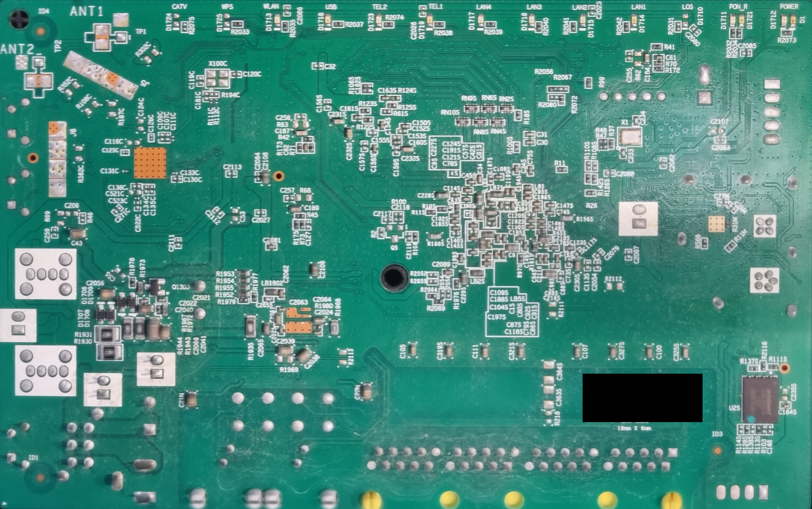

# Hardware and photographs

I compared photographs with manufacturer documentation to identify the hardware. The photographs below show both PCB surfaces and backside details.

| Component | Identification from research | Limit |
| --- | --- | --- |
| Main processor | HiSilicon SD5117P / RBCV100 marking | Exact clocks, enabled cores and pad routing unverified |
| DRAM | SK hynix H5TQ2G63GFR-RDC, 2 Gbit / 256 MiB DDR3 | Part capacity, not a live usable-memory measurement |
| Flash at U2S | Winbond W25N01GVZEIG, 1 Gbit / 128 MiB SPI NAND | Contents and actual board voltage unmeasured |
| Ethernet magnetics | MNC / Mentech H4001CG | Part identification alone does not establish board throughput |
| Telephone interface at U1N | Le9642PQC | Presence does not establish active voice service |
| Protection at U2N/U3N | ST LCP1521S family, CP152S marking | Routing and protection performance unmeasured |
| Transistor at Q1302 | Probable Diodes Incorporated / Zetex ZX5T955G, marked X5T / 955; PNP, SOT223 | Faint photo marking and package support the match; exact circuit role untraced |
| Rectifier near Q1302 | MCC ES1D-family, 1 A / 200 V, SMA | Marking is legible; exact ordering suffix and circuit role unverified |

Q1302 and the ES1D diode sit near the power switch and capacitors. The [ZX5T955G datasheet](https://www.diodes.com/datasheet/download/ZX5T955G.pdf) specifies the `X5T / 955 / YWW` marking layout; the middle line appears to be `955`, rather than the initially reported `995`. A `912` lower line would encode a year ending in 9 and week 12, without identifying the decade.

The [MCC catalog](https://www.mccsemi.com/pdf/MCCProductCatalog.pdf) lists the ES1D-L family as a 1 A, 200 V SMA rectifier. These are discrete semiconductor components. Their ratings do not establish circuit voltages or the function of either component on this board.

Manufacturer and related-device sources are listed in [references](references.md). Related-device ARM/Linux evidence is supporting inference, not a board-specific boot log.

## Public photographs

Single-frame detail of the connector region. I kept the original framing, removed identifying metadata and selected this frame because it excludes the identifying sticker.

A second single-frame view of backside traces and footprints. Focus and glare limit fine-lettering interpretation. No component function or signal assignment is inferred from appearance alone.

Both images retain original encoded pixel data, without AI-generated reconstruction. Original files are unchanged. See [image provenance](../images/README.md).

## Flat side — top-facing inside the device

[Open the full-resolution image: 14,216 × 8,923 pixels](../images/pcb/pcb-flat-side-full.jpg).

This composite combines 694 photographs of the side without capacitors. The embedded preview is smaller; the linked JPEG retains the native mosaic dimensions. The serial/QR sticker was covered in GIMP before export. No generated detail or enlargement was applied. Source blur, reflections and alignment limits can remain.

## Component side — bottom-facing inside the device

This composite combines a 1,297-photo dataset. The local lossless master is 13,311 × 8,407 pixels; this documentation image is a reduced JPEG. Processing combined PCB-surface registration, native focus selection, a reviewed capacitor-region focus stack and coherent source views for raised components. Outside-scene background was removed without inpainting or generated detail.

Originals remain unchanged. Source softness, lighting differences and small local seam or perspective errors can remain. The composite is not a calibrated measurement. See [image provenance](../images/README.md).

## Unresolved hardware questions

The previously observed five-pad footprint is only a debug-interface candidate: function, pinout and voltage remain unverified. Unpopulated footprints and USB/WLAN silkscreen are not proof of functioning interfaces. No wiring instructions are provided.

Both board surfaces are shown above. The original flat-side mosaic retains its identifying sticker; the shared derivative covers it.

---

[Next page: Finding summary and limits →](findings/ONR-WEB-001.md)
